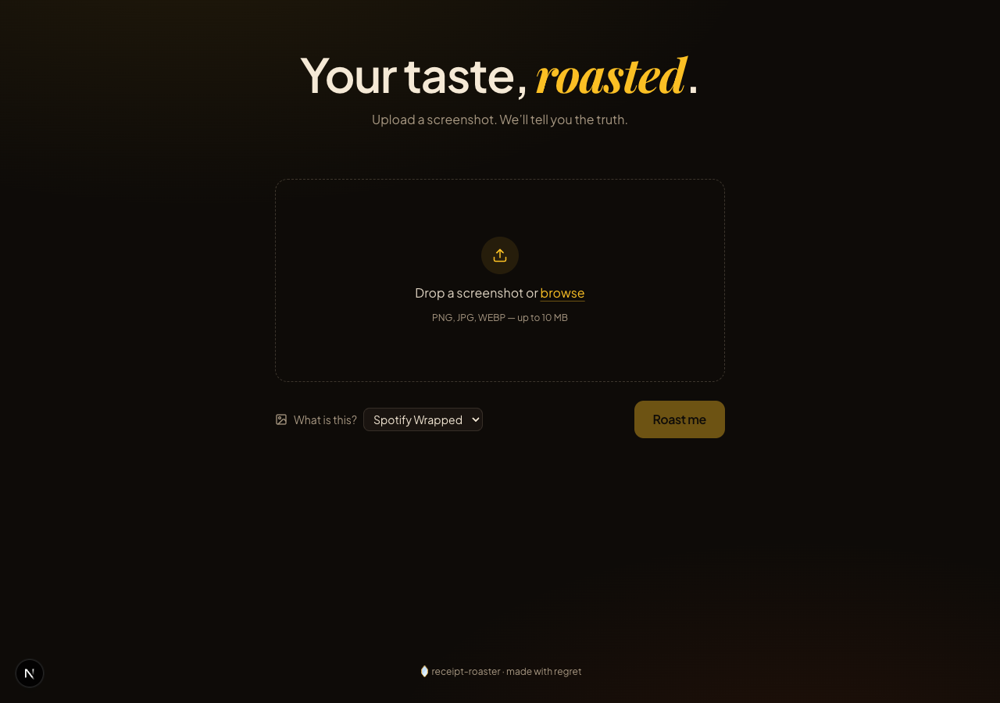

# 🪞 Receipt Roaster

> Your taste, roasted.



Upload your Spotify Wrapped, Letterboxd, Goodreads — anything that exposes your taste — and an AI delivers a sharp, specific, slightly affectionate roast. Download it as a 1080×1350 image card and post the receipts.

## Stack

- Next.js 15 · App Router · TypeScript
- Tailwind CSS v4 (CSS-first `@theme`)
- OpenAI `gpt-4o` vision
- `html-to-image` for PNG export
- Framer Motion · lucide-react
- Playfair Display · Plus Jakarta Sans · JetBrains Mono

## Setup

```bash
pnpm install
cp .env.example .env.local
# add your OPENAI_API_KEY
pnpm dev
```

Open http://localhost:3000.

## How it works

1. You upload a screenshot.
2. The image (as a data URL) is POSTed to `/api/roast`.
3. The route hands the image to `gpt-4o` with a system prompt tuned for sharp, specific, redemptive roasts (see `src/lib/prompt.ts`).
4. The model returns `{ roast, vibe }` as JSON.
5. The result renders in the UI; an offscreen card at 1080×1350 is rasterized to PNG via `html-to-image` for download.

## Out of scope (v0.1)

- Auth, accounts, persistence, history
- Social platform sharing beyond Web Share API
- Analytics / rate limiting
- i18n

## License

MIT

## Terms & Disclaimer

By using this project you agree to the following.

- **No warranty.** This software is provided "as is", without warranty of any kind, express or implied, including merchantability, fitness for a particular purpose, and non-infringement.
- **No liability.** To the maximum extent permitted by law, the author and contributors are not liable for any claim, loss, or damage (direct, indirect, incidental, or consequential, including lost data or profits) arising from its use.
- **Your responsibility.** You use it at your own risk and are responsible for complying with the laws that apply to you.
- **AI output.** Generated content can be inaccurate, biased, or offensive. Review it before relying on or sharing it. Third-party AI providers you configure process your input under their own terms.
- Spotify, Letterboxd, and Goodreads are trademarks of their owners; this project is not affiliated with them. Only upload exports of your own data.
- **Third parties.** Names, logos, APIs, and services of others belong to their owners and are used for identification only; no affiliation or endorsement is implied.
- **Your statutory rights.** Nothing here limits rights that cannot be waived by agreement, including under consumer-protection laws in the USA, Canada (including Quebec), and India (Consumer Protection Act, 2019).
- **License.** Use, copying, and distribution are governed by the [LICENSE](LICENSE) file; if anything here conflicts with it, the license controls.
